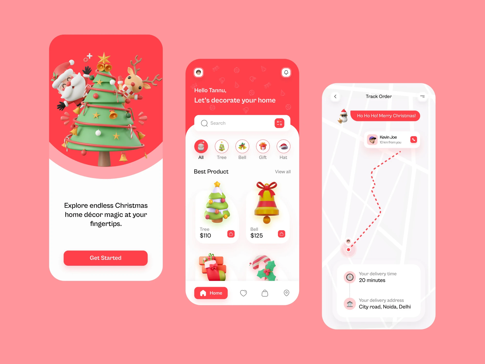
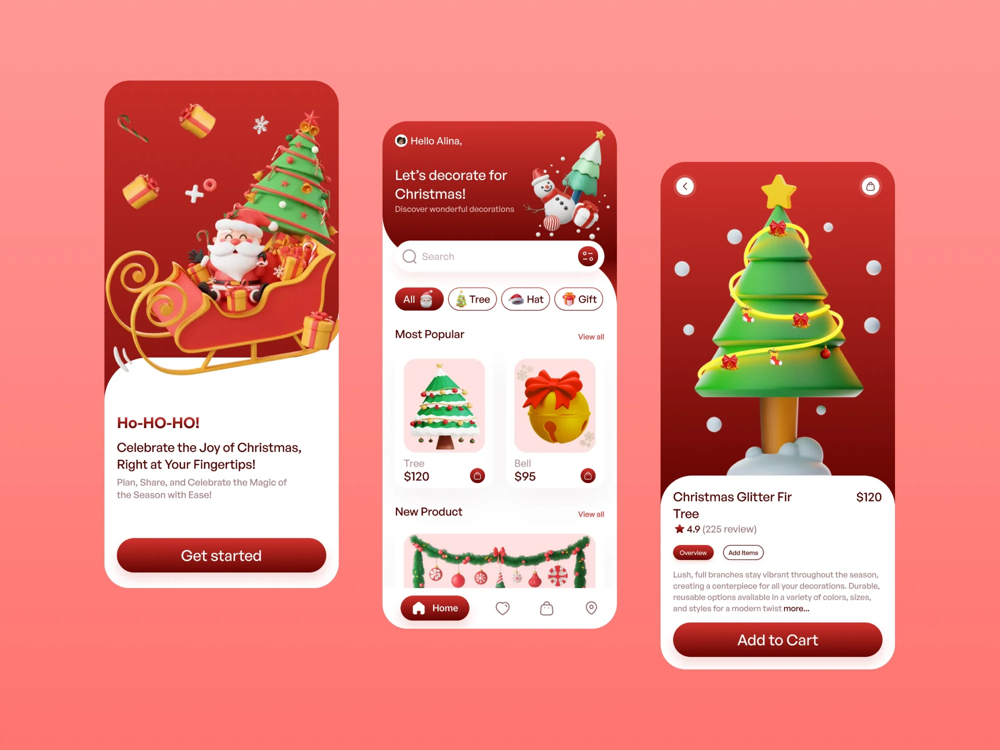
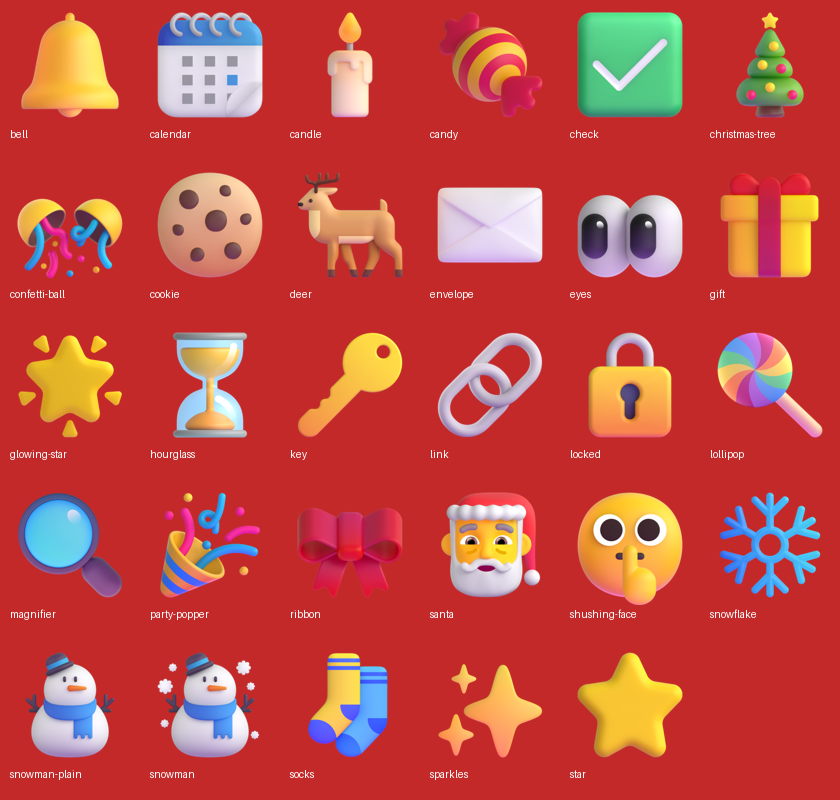

# Paskonect — Art Direction

How Paskonect should look and feel. Read this alongside [`SPEC.md`](SPEC.md) before
building any screen.

**Version:** 1.0
**Status:** Pre-build

---

## 1. References

Two mood boards set the direction. Both are mobile Christmas décor shop concepts.
We're borrowing their look, not their features.

| Peg | File | What to take from it |
|---|---|---|
| **Peg 1 — Coral** | [`references/peg-1-coral.webp`](references/peg-1-coral.webp) | Bright, flat coral red, round icon chips, playful 3D characters, the curved hero edge, the pink "glow" arc behind the hero |
| **Peg 2 — Crimson** | [`references/peg-2-crimson.webp`](references/peg-2-crimson.webp) | Deeper crimson gradients, pill-shaped category chips, the big full-bleed hero image on detail screens, the gradient primary button |





**The blend:** Peg 2's crimson gradients for headers and primary buttons, Peg 1's
brighter coral for small accents and icon chips. White content cards on top of
both.

### What *not* to copy

The pegs are online shops. Paskonect is not. Leave out:

- Prices, product grids, "Add to Cart", shopping bag icons
- Order tracking and delivery maps
- Star ratings and review counts

Each of those patterns has a Paskonect equivalent in section 6.

---

## 2. Mood

**Festive, warm, playful, trustworthy.**

It should feel like opening a present: a burst of red and 3D characters at the top,
then calm white space where the useful content lives. Fun on the outside, clear on
the inside.

The app holds a secret: who's giving to whom. The design should make that secret
feel special, like a reveal moment, not like a database lookup.

---

## 3. Color

Sampled from the reference images.

### Brand

| Token | Hex | Use |
|---|---|---|
| `crimson-900` | `#780A0B` | Gradient end, darkest red, pressed states |
| `crimson-700` | `#901C1B` | Headings on white (e.g. "Ho-HO-HO!") |
| `crimson-600` | `#C42929` | Gradient start, header backgrounds |
| `coral-500` | `#FF404A` | Accent: icon chips, active nav item, small buttons, badges |
| `coral-300` | `#FFA7AE` | Soft glow arc behind hero art |
| `blush-200` | `#FF959B` | Page background on desktop, behind the app frame |
| `blush-100` | `#FFE4E6` | Image wells inside cards, selected-row tint |

### Neutrals

| Token | Hex | Use |
|---|---|---|
| `white` | `#FFFFFF` | Cards, inputs |
| `snow` | `#FCFBFC` | Screen background |
| `mist` | `#F3F1F3` | Dividers, disabled fills |
| `gray-400` | `#A3A1A6` | Muted labels ("Tree", "View all", placeholders) |
| `ink` | `#1C1A1F` | Body text and prices-equivalent numbers |

### Supporting festive accents

Use sparingly, mostly inside illustrations and status badges.

| Token | Hex | Use |
|---|---|---|
| `pine` | `#2FA35A` | Success states ("Draw is valid", "Joined") |
| `gold` | `#F5B82E` | Highlights, the star on top of the tree, "Viewed" badge |

### Gradients

- **Hero / header:** `linear-gradient(180deg, #C42929 0%, #8B1414 100%)`
- **Primary button:** `linear-gradient(180deg, #C42929 0%, #780A0B 100%)`
- **Desktop page background:** `linear-gradient(180deg, #FF9793 0%, #FF7572 100%)`

### Rules

- Red is for headers, primary actions and accents. Content areas stay white.
- Text on red is always white. Text on white is `ink` or `crimson-700`.
- Check contrast: white on `coral-500` is borderline for small text. Use it for
  icons and 16px+ semibold labels only. Use `crimson-600` or darker behind small
  white text.

---

## 4. Typography

Both pegs use a rounded geometric sans-serif with friendly, open letterforms.

- **Typeface:** [Plus Jakarta Sans](https://fonts.google.com/specimen/Plus+Jakarta+Sans),
  loaded with `next/font/google`. Free, close to the references, good weight range.
  Fallback: `ui-sans-serif, system-ui, sans-serif`.
- **One family only.** Weight and size do the work.

| Style | Size / line height | Weight | Example |
|---|---|---|---|
| Display | 32 / 38 | 700 | "Ho-HO-HO!" |
| H1 | 26 / 32 | 600 | "Let's decorate for Christmas!" |
| H2 | 20 / 26 | 600 | "Most Popular" section headers |
| Body | 16 / 24 | 400 | Wishlist text, descriptions |
| Label | 14 / 20 | 500 | Chip text, card captions |
| Caption | 12 / 16 | 400 | Timestamps, "10 km from you"-style metadata |

Greetings use the participant's name, like "Hello Alina,": light weight on the
first line, heavier headline below.

---

## 5. Shape, depth and layout

### Radius

Everything is round. No sharp corners anywhere.

| Element | Radius |
|---|---|
| App frame / hero container (desktop) | 40px |
| Cards | 24px |
| Inputs, search bar | 16px |
| Buttons, chips, nav pill | Full (`9999px`) |
| Small icon buttons | 12px |

### The curved hero edge

The signature shape in both pegs: the red hero section ends in a big soft curve,
not a straight line, with white content rising into it. Peg 1 adds a lighter
`coral-300` band just behind the curve. Use an SVG path or a large `border-radius`
on an oversized element to get this.

### Shadows

Soft, low and slightly warm. Never harsh gray.

- **Card:** `0 8px 24px rgba(196, 41, 41, 0.08)`
- **Floating (search bar, primary button):** `0 12px 32px rgba(196, 41, 41, 0.18)`

### Spacing

4px base grid. Screen side padding 24px on mobile. 16px gaps between cards, 32px
between sections.

### Layout

- **Mobile first.** The pegs are phone screens and most participants will open
  their link from a group chat on a phone.
- **On desktop**, center the app in a phone-width column (max ~480px) on the
  blush gradient background, like the reference boards. The organizer dashboard
  may widen to ~960px with a two-column roster.
- **Bottom nav** on mobile: a white bar with a red pill around the active item
  ("Home") and outline icons for the rest.

---

## 6. Screen-by-screen translation

How each pattern from the pegs maps onto Paskonect's screens.

| Peg pattern | Paskonect screen | Notes |
|---|---|---|
| Onboarding: hero art + headline + "Get started" | **Landing page** | "Ho-HO-HO!" headline, one-line pitch, "Create a room" button for organizers |
| Home: greeting header + search + category chips | **Organizer dashboard** | "Hello Alina," greeting. Chips filter the roster: All / Joined / Viewed / Not viewed |
| Product cards with image well + label + price | **Roster cards** | Avatar in the image well, display name, status badge (Joined / Viewed) instead of a price. Small round button opens "Re-issue link" |
| Product detail: full-bleed hero + white sheet + "Add to Cart" | **Reveal page** | The receiver's name on a big red hero with a 3D gift, white sheet slides up with their wishlist and "updated 2 hours ago". This is the most important screen to get right |
| Overview / Add Items pill tabs | **Reveal page tabs** | "Their wishlist" / "My wishlist" |
| Track Order: Santa speech bubble + timeline card | **Room status / themes** | Santa bubble for announcements ("Names drawn!"). Vertical timeline for the weekly theme schedule |
| Search bar with filter button | **Join page** | Swap for the room code input: "Enter room code" with a go button |
| Rating line under a title | **Room info line** | Budget and participant count: "₱500 budget · 12 joined" |

---

## 7. Illustration

The pegs' biggest personality comes from **glossy 3D clay-style illustrations**:
Santa, reindeer, snowman, trees, bells, gifts, candy.

### Source: Microsoft Fluent Emoji 3D (already in the repo)

We don't make or buy custom illustrations. We use
[Microsoft Fluent Emoji](https://github.com/microsoft/fluentui-emoji) in their 3D
style: free, MIT-licensed, and the same glossy, soft, front-lit look as the pegs.

29 assets are already in [`public/illustrations/`](../public/illustrations/), with
sources and license in [`CREDITS.md`](../public/illustrations/CREDITS.md).



### Where each one goes

| Screen / use | Illustrations |
|---|---|
| Landing hero | `santa`, `christmas-tree`, `gift`, `deer`, `glowing-star`, `snowflake` |
| Join page | `gift`, `ribbon`, `sparkles` |
| Personal link / "save this link" | `key` (the token is your door key), `link` |
| Reveal moment | `gift` → `party-popper`, `confetti-ball`, `sparkles` |
| Pre-draw reveal state ("Names not drawn yet") | `hourglass`, `shushing-face` |
| Invalid or revoked link | `locked` |
| Room locked after draw | `locked`, `check` |
| Email recovery | `envelope` |
| Weekly themes timeline | `calendar`, plus a theme icon per week (`socks`, `cookie`, `candle`, `candy`…) |
| Dashboard "Viewed" status | `eyes` |
| Validation panel | `check` |
| Empty roster | `snowman` |
| Search / no results | `magnifier`, `snowman-plain` |
| Category-style chips (roster filters, theme tags) | Any, at 24–32px inside a round chip |

### Working within the 256px limit

Every asset is 256×256. On a 2x phone screen that stays sharp up to **128 CSS px**.
So:

- **Never show a single illustration larger than 128px.** Don't upscale.
- **Build heroes as compositions, not one big picture.** Cluster 3–6 illustrations
  at different sizes (48–128px), slightly rotated (−12° to 12°) and overlapping,
  like the scattered gifts and stars in Peg 2's onboarding screen. Make the
  centerpiece the largest (128px) and keep the others smaller around it.
- **Fill the space with CSS, not images:** blurred coral circles behind the cluster
  (`blur(40px)`, `coral-300` at 60%), white "snow" dots like Peg 2's product hero,
  and the faint ornament pattern from Peg 1's header.
- **Soft drop shadow** under each cluster item: `drop-shadow(0 8px 12px rgba(120, 10, 11, 0.25))`.
- Build these as one reusable `<HeroCluster>` component that takes a list of
  `{ src, size, x, y, rotate }`.

### Rules

- **Where:** hero sections, empty states, the reveal moment, status states, chips.
- **Never:** inside dense UI like tables or forms.
- **Don't mix styles:** no flat vector clip art, no photos, no other emoji sets.
- **Format:** use `next/image` with explicit `width`/`height`. Mark decorative
  ones `alt=""`.
- **Adding more:** take another Fluent Emoji 3D asset (check its `3D/` folder),
  convert it to WebP and add a row to `CREDITS.md`.
- **Gaps in the set:** there is no candy cane, wreath or Santa hat. Use `candy`,
  `ribbon` and `santa` instead.

### Iconography

UI icons are thin outline icons, ~1.75px stroke, rounded caps (e.g.
[Lucide](https://lucide.dev)). Active state: filled white icon inside a red pill or
circle.

### Background confetti

Peg 1's header has faint outlined ornaments (baubles, bells, candy) scattered at
~10% white opacity. Use this as a subtle texture on red headers only.

---

## 8. Motion

Light and celebratory, never in the way.

- **Taps:** buttons and chips scale to 0.97 on press, 120ms.
- **Screen transitions:** content cards rise 16px and fade in, 200ms ease-out,
  staggered by 40ms.
- **The reveal:** the one place to go big. The receiver's name and the hero art
  pop in with a gentle spring, plus a short confetti or snowfall burst. Under ~1.5s
  total and plays only on first view (tied to `viewed_at`).
- **Respect `prefers-reduced-motion`:** swap all movement for simple fades.

---

## 9. Voice

Copy matches the visuals: warm, short, a little playful.

- Greet by name: "Hello Alina,"
- Festive headlines, plain instructions: "Ho-HO-HO! You're giving to **Maria**." then
  "Here's what she's hoping for."
- Filipino Christmas flavor is welcome ("Maligayang Pasko!", "Manito/Manita")
  but every instruction must still make sense in plain English.
- Buttons say exactly what happens: "Join room", "Draw names", "Copy my link".
- Never cute where it could confuse. Error messages and the irreversible draw
  confirmation are plain and direct.

---

## 10. Accessibility

Festive must not mean hard to use.

- Text contrast at least 4.5:1 (3:1 for 18px+ bold).
- Tap targets at least 44×44px.
- Illustrations are decorative: `alt=""` unless they carry meaning.
- Status is never color-only: badges include text ("Viewed"), not just a dot.
- Visible focus rings: 2px `gold` outline with 2px offset, so they show on both red
  and white.

---

## 11. Tailwind setup

Starting point for `tailwind.config.ts` (or `@theme` in Tailwind v4):

```ts
colors: {
  crimson: { 600: '#C42929', 700: '#901C1B', 900: '#780A0B' },
  coral:   { 300: '#FFA7AE', 500: '#FF404A' },
  blush:   { 100: '#FFE4E6', 200: '#FF959B' },
  snow:  '#FCFBFC',
  mist:  '#F3F1F3',
  ink:   '#1C1A1F',
  pine:  '#2FA35A',
  gold:  '#F5B82E',
},
borderRadius: {
  card: '24px',
  frame: '40px',
},
boxShadow: {
  card:  '0 8px 24px rgba(196, 41, 41, 0.08)',
  float: '0 12px 32px rgba(196, 41, 41, 0.18)',
},
fontFamily: {
  sans: ['var(--font-jakarta)', 'ui-sans-serif', 'system-ui', 'sans-serif'],
},
```
